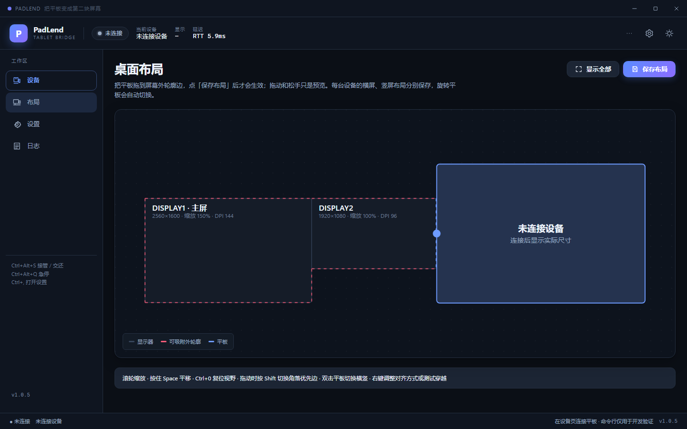

# PadLend

跨设备共享键鼠无缝操作平板。鼠标移到电脑屏幕边缘时会穿到平板上，平板出现系统指针，可以直接用鼠标和键盘操作；从平板边缘划回来，指针回到电脑上原来的位置。

一般不需要 root，不需要在平板上安装 App，也不用装驱动。PC 端通过 adb 启动 scrcpy-server，平板通过 UHID 接收虚拟鼠标和键盘输入。

当前源码版本 **1.2.1**（最新发布仍为 1.2.0），Apache-2.0。1.2.1 把「保持平板亮屏」从开发者选项的 `svc power stayon` 改为连接期间临时调大系统的 `screen_off_timeout`（断开还原），删除没有运行时实现的「显示指针幽灵」开关，并把首次向导从 5 步压成 3 步；adb 与 scrcpy-server 仍随包内置。1.2.0 修复托盘点「退出」只隐藏窗口、接管期按 Win 键会把开始菜单盖在遮罩下（看起来像死机），以及崩溃/强杀后遗留孤儿遮罩的问题；同时把退出清理改成同步、幂等，并补上父进程看门狗。1.1.2 修复接管交还后遮罩窗口残留，1.1.1 修复接管期间电脑屏幕上重新出现鼠标指针；1.1.0 起前端为 **Tauri 2 + React 19 + TypeScript**，业务引擎仍由 Python 服务进程承载，不再依赖 Qt/PySide6。选型理由与迁移细节见 [docs/TAURI_MIGRATION.md](docs/TAURI_MIGRATION.md)，引擎设计见 [docs/DESIGN.md](docs/DESIGN.md)，遇到问题先看 [docs/TROUBLESHOOTING.md](docs/TROUBLESHOOTING.md)，开发期踩坑见 [docs/PITFALLS.md](docs/PITFALLS.md)。



*界面截图使用演示设备数据；布局页可把平板拖到任意显示器边缘，点「保存布局」后生效。*

## 功能

- 平板按显示器边缘摆位（只共享键鼠，不占用一块显示器），支持多显示器、负坐标和混合 DPI。
- 鼠标从屏幕边缘进入平板后 1:1 移动；从平板边缘继续外推，交还给 PC。
- 通过 UHID 创建虚拟鼠标/键盘，平板显示真实的系统指针，右键、滚轮、侧键都能用。
- 键盘转发，支持中文输入法；`Ctrl+Alt+S` 手动接管/交还，`Ctrl+Alt+Q` 急停。
- 剪贴板双向同步：PC 复制自动写入平板，平板复制也会写回 Windows；只写剪贴板，不敲键盘。
- 布局页可视化摆位：拖到合法边缘后点「保存布局」才生效；角落按 `Shift` 切换优先边，点「显示全部」可一次看全所有显示器和平板。
- 每台设备的横屏、竖屏布局分别保存；平板旋转时按真实朝向自动切换到对应布局。
- 日间/夜间主题、托盘菜单、日志查看、脱敏诊断包。
- 退出时恢复平板指针速度，并清理遮罩、ClipCursor 和 UHID 设备。

## 环境要求

| | |
|---|---|
| PC | Windows 10/11 x64，需 WebView2 Runtime（Win11 通常已内置） |
| 平板 | Android 8.0+，且 `/dev/uhid` 可写 |
| 连接 | USB 数据线（推荐）或无线 adb |
| 开发 | Node.js 22+、Rust 1.77+ / MSVC、Python 3.11+（开发使用 3.13） |

已在 Honor MagicPad 3（CGA-W00，Android 17，3200×2136）上验证。其他机型只要 UHID 可用，首次连接会读取真实分辨率、朝向和输入参数，不按型号写死。

UHID 是硬条件。`/dev/uhid` 不可写时无法创建虚拟鼠标/键盘，平板不会出现系统光标，键鼠输入也无法接管。可以先在电脑上执行：

```bash
adb shell 'exec 3<>/dev/uhid && echo OPEN_OK'
```

返回 `OPEN_OK` 才说明可用。失败时需要换支持 UHID 的机型/ROM，或在 userdebug 固件上 `adb root` 后再试。详见[故障排查](docs/TROUBLESHOOTING.md)。

## 下载与安装

到 [GitHub Releases](https://github.com/measureer/PadLend/releases) 下载最新发布：

- `PadLend-1.2.0-setup.exe`：NSIS 安装器，装到当前用户目录，不需要管理员权限。
- `PadLend-1.2.0-win64.zip`：免安装包，解压即用。
- `SHA256SUMS.txt`：下载后建议核对。

```powershell
Get-FileHash .\PadLend-1.2.0-win64.zip -Algorithm SHA256
```

安装器默认装到 `%LOCALAPPDATA%\Programs\PadLend`。配置和日志默认写在 `%APPDATA%\PadLend\`，升级覆盖程序目录不会丢配置。免安装包请保持 `PadLend.exe`、sidecar exe 与 `vendor\` 在同一目录。

> 当前构建没有代码签名，Windows 可能提示「未知发布者」；点「更多信息 → 仍要运行」，或按 SHA-256 核对。

## 快速开始

1. 运行 PadLend。第一次启动会打开向导，检查平板连接/USB 调试和 UHID，最后可以设置是否自动连接、关闭窗口时是否收进托盘。adb 和 scrcpy-server 已随安装包内置，不需要另外安装。
2. 在平板上打开「开发者选项 → USB 调试」，用数据线连接电脑。没有设备时，在「设备」页点「添加设备」，填无线调试的 IP 和端口；首次配对还要填 6 位配对码。设备页的「刷新设备」会重新扫描 adb；如果 adb 自带的 mDNS 不可用，PadLend 会自己发 mDNS 查询找无线调试端口，再按每台设备保存的 MAC 用 ARP 表确认新 IP。
3. 选中平板，点「连接此设备」。
4. 切到「布局」页，把平板拖到某个屏幕边缘的红色虚线区域，点「保存布局」。拖动和松手只是预览，不点保存不会改变实际摆位；「显示全部」会把所有显示器和平板缩放到视野内。角落位置按 `Shift` 切换优先边。布局按「设备 + 横屏/竖屏」分别保存，旋转平板后会自动切到该方向保存过的布局。
5. 把鼠标移到该边缘并继续往外推，进入接管：PC 光标隐藏，平板出现指针。把指针推到平板对应边缘再往外推，交还给 PC。

### 热键

| 热键 | 作用 |
|---|---|
| `Ctrl+Alt+S` | 手动接管 / 交还 |
| `Ctrl+Alt+Q` | 急停，立即释放鼠标、键盘和 ClipCursor |
| `Ctrl+,` | 打开设置页 |
| `Ctrl+0` | 布局画布复位视野 |

热键可以在设置里改，对应 `hotkeys.toggle` 和 `hotkeys.panic`。

### 状态颜色

| 颜色 | 状态 | 含义 |
|---|---|---|
| 灰 | 未连接 | 设备未连接，输入归 PC |
| 绿 | IDLE | 已连接，未接管 |
| 黄 | ARMING / RETURNING | 正在判断是否进入，或正在交还 |
| 红 | CAPTURED | 接管中 |
| 红（错误色） | FAULT | 连接或钩子异常，输入已交还系统 |

## 配置

配置文件在 `%APPDATA%\PadLend\config.yaml`，日志在同目录的 `logs\` 下。设置 `PADLEND_HOME` 可以换一个根目录；`%APPDATA%` 不可写时会依次回退到 `%LOCALAPPDATA%\PadLend` 和程序目录下的 `.padlend\`。

首次启动会自动生成配置。常用字段：

```yaml
version: 1
device:
  serial: ""              # 空 = 自动选择第一台
  prefer_usb: true
  auto_connect: true      # false = 启动后不自动连接，在设备页手动连接
  server_port: 1234       # 1024–65535
  known: []               # 最近连接过的序列号（自动维护）
  macs: {}                # 每台无线设备的 Wi-Fi MAC，键为地址（自动维护）
placement:
  monitor: ""             # 空 = 主屏
  edge: right             # left / right / top / bottom
  span_start: 0
  span_end: 1600
  offset: 0.5             # 0–1，该边段内的相对落点
  align: proportional     # proportional / center / one_to_one
  corner_priority: right  # 角落争夺时优先的边
layouts:
  devices: {}             # 每台设备 × 横/竖屏的布局，保存布局时自动维护
motion:
  gain: 1.0               # 0.25–3.0
  report_hz: 1000         # 125 / 250 / 500 / 1000
  hid_clamp: 127          # 1–127，单次 HID 位移上限
  entry_margin_px: 2
  exit_overflow_px: 80    # 交还所需的外推距离
  debounce_ms: 250
  arm_px: 10
  arm_window_ms: 80
  edge_band_px: 1
  boundary_inset_px: 0    # 平板拦截边缘手势时可调 8–16
keyboard:
  forward: true
  suppress_pc: true
  layout: us
  passthrough_keys: []    # 1.2.0 起接管期 Win 键由 Router 强制吞掉；这里只配其它放行键
hotkeys:
  toggle: "Ctrl+Alt+S"
  panic: "Ctrl+Alt+Q"
ui:
  language: zh_CN         # 预留字段，目前仅中文界面
  theme: dark             # dark / light
  tray_notifications: true
  close_to_tray: false    # 关闭主窗时收进托盘继续运行
misc:
  clipboard_sync: true
  keep_screen_on: true
  restore_pointer_speed: -3
```

设置页能改手感、键盘、快捷键和杂项；改动先留在草稿里，点「保存设置」才写入并校验。`keep_screen_on` 在连接期间临时调大平板的系统熄屏超时，断开后还原；不会改开发者选项里的「保持唤醒状态」。平板摆位在「桌面布局」页调整：拖动只预览，点「保存布局」才会写入配置并立即用于边缘穿越。

YAML 损坏、字段越界或版本过新时，程序会把原文件备份成 `config.yaml.bad-<时间戳>`，恢复默认值，并在设置页底部显示原因。

## 日志与诊断

- `%APPDATA%\PadLend\logs\padlend.log`：运行日志，2 MB 轮转，保留 3 个文件。
- `logs\crash-YYYYmmdd-HHMMSS-<pid>.log`：未捕获异常的 traceback、版本和启动参数。
- `logs\faulthandler-*.log`：原生崩溃时的全线程栈。
- 托盘菜单的「打开日志目录…」可以直接打开上述目录。
- 顶栏 `⋯` →「运行诊断…」会采集 adb 设备、dumpsys input、pointer_speed、UHID 状态和最近 512 KB 日志，并可导出 zip。序列号、IP、MAC、用户名和用户目录默认打码。
- 托盘菜单的「复制诊断信息」只复制版本、系统、jar 状态等静态摘要，不会跑 adb。

## 常见问题

| 现象 | 先看 |
|---|---|
| SmartScreen 提示「未知发布者」 | 点「更多信息 → 仍要运行」，或核对 SHA-256 |
| 提示缺少 WebView2 | 安装 [WebView2 Runtime](https://developer.microsoft.com/microsoft-edge/webview2/) |
| 找不到 scrcpy-server jar，或校验失败 | 重新解压发布包；`vendor/scrcpy-server-v5.0.1.jar` 缺失或与 `vendor/SHA256SUMS` 不符 |
| 平板不显示光标，键鼠没反应 | UHID 不可写，先按上面的命令自检 |
| 设备页显示 unauthorized | 在平板上点「允许 USB 调试」，勾选「始终允许」，再刷新 |
| 无线 adb 连不上 | 确认平板和电脑在同一网段，无线调试端口没被路由器隔离；重新配对 |
| 边缘手势被平板抢走 | 调大 `motion.boundary_inset_px`（8–16） |
| 交还太灵敏或太迟钝 | 调 `motion.exit_overflow_px`（默认 80）或 `debounce_ms` |

更完整的排障步骤见 [docs/TROUBLESHOOTING.md](docs/TROUBLESHOOTING.md)；开发期踩坑与失效安全记录见 [docs/PITFALLS.md](docs/PITFALLS.md)。

## 架构

```text
PadLend/
├─ src/                    # React 19 + TS 前端（设计系统、页面、对话框、状态）
│  ├─ api/                 # 传输契约 + 浏览器演示后端
│  ├─ store/               # 单一状态源与事件订阅
│  ├─ lib/                 # 纯逻辑、动作编排、几何与配置 schema
│  ├─ components/          # 统一组件库与图标
│  └─ features/            # 设备 / 布局 / 设置 / 日志 / 向导 / 诊断
├─ src-tauri/              # Tauri 2 Rust 外壳（窗口、托盘、单实例、剪贴板、sidecar 生命周期）
├─ service/                # Python 业务服务（NDJSON over stdin/stdout）
├─ core/                   # 状态机、几何、指标、错误、日志、崩溃、诊断
├─ win/                    # DPI、桌面几何、Raw Input、遮罩、钩子、热键
├─ tablet/                 # adb、协议、UHID、server、session、键盘映射
├─ config.py / constants.py / main.py
├─ tools/                  # 探针、验收、发版、sidecar 与图标构建
├─ vendor/                 # scrcpy-server jar、内置 adb、SHA256SUMS
├─ frontend-dist/          # 前端构建输出（与 dist/ 分离）
└─ dist/                   # 发布产物
```

线程模型：Tauri WebView 只负责渲染；Rust 外壳转发 RPC；Python 服务用线程池跑耗时操作，Router / 发送 / 监督 / Raw Input / 键盘钩子各占独立线程。发送队列满时丢最老的输入，并计入 `drop_pct`。

> `docs/DESIGN.md` 等历史文档描述的是引擎与协议设计，仍然有效；其中涉及 Qt 窗口/控件的章节属于 1.0.x 旧界面，已由 `docs/TAURI_MIGRATION.md` 取代。

## 从源码构建

```powershell
# 前端与业务服务（Python）
python -m venv .venv
.\.venv\Scripts\python.exe -m pip install -U pip
.\.venv\Scripts\python.exe -m pip install -e ".[dev]"
npm ci

# 浏览器预览（无需 Rust，使用内存演示设备）
npm run dev
# http://127.0.0.1:1420/?page=layout&theme=light

# 单独启动业务服务
.\.venv\Scripts\python.exe -m service --simulate --no-hooks

# 完整桌面应用（需要 Rust 1.77+ / MSVC / WebView2）
.\.venv\Scripts\python.exe tools\build_sidecar.py
npm run tauri:dev
npm run tauri:build
```

一条命令构建并打发布包（本机没有 Rust 时会跳过原生外壳，CI 会补全）：

```powershell
.\.venv\Scripts\python.exe tools\release.py --build --zip --sha256
```

`vendor/scrcpy-server-v5.0.1.jar` 和 `vendor/adb/platform-tools/` 随仓库提供，校验和见 `vendor/SHA256SUMS`。adb 的查找顺序是：`PADLEND_ADB` → 内置 `vendor/adb/platform-tools/` → PATH → 常见 SDK 目录。

## 开发与验收

```powershell
.\.venv\Scripts\python.exe -m pytest -q       # 引擎 + 服务协议测试
.\.venv\Scripts\python.exe -m ruff check .
npx vitest run                               # 前端单元与交互测试
npm run build                                # tsc --noEmit + vite build
.\.venv\Scripts\python.exe tools\probe.py    # 探测真实设备
.\.venv\Scripts\python.exe tools\acceptance.py  # 端到端验收（假平板 + 真实遮罩/状态机）
```

`acceptance.py` 走真实代码路径，不 mock 被测逻辑。进入接管后会检查遮罩是否吞掉 `WM_SETCURSOR`、`ClipCursor` 是否钉在屏幕边缘的 1px 条上，再用真实输入事件验证单击、连点、双击和拖动，最后交还并检查遮罩销毁、`ClipCursor` 解除。

## 已知限制

- 未签名：没有代码签名证书，SmartScreen 会提示「未知发布者」。
- 管理员窗口收不到输入：以管理员权限运行的窗口收不到低级键盘/鼠标钩子，这是 Windows 的限制。
- UHID 是硬条件：`/dev/uhid` 不可写时无法创建虚拟鼠标/键盘，不能接管输入。
- 多显示器组合（负坐标、跨屏同侧、角落裁决）有 fixture 单测覆盖，但仍需要双屏实机复验。
- 无线性能：adbd 抖动时降低 `report_hz` 或改用 USB；部分路由器开了 AP 隔离时无线调试不可用。
- 无自动更新：升级时下载新 Release，覆盖程序目录即可，配置会保留。
- 当前只有中文界面。

## 许可

Apache-2.0。Tauri、React、scrcpy、Android platform-tools、PyYAML、psutil、PyInstaller 等第三方组件的许可证和归属见 [THIRD_PARTY_NOTICES.md](THIRD_PARTY_NOTICES.md)，发布包的 `LICENSES/` 目录里有许可证原文。程序内「关于 PadLend…」可以查看版本、许可摘要并打开该文件。

平板端的 scrcpy server jar 和协议来自 [scrcpy](https://github.com/Genymobile/scrcpy)（Apache-2.0），PadLend 侧的协议实现是独立编写的。
