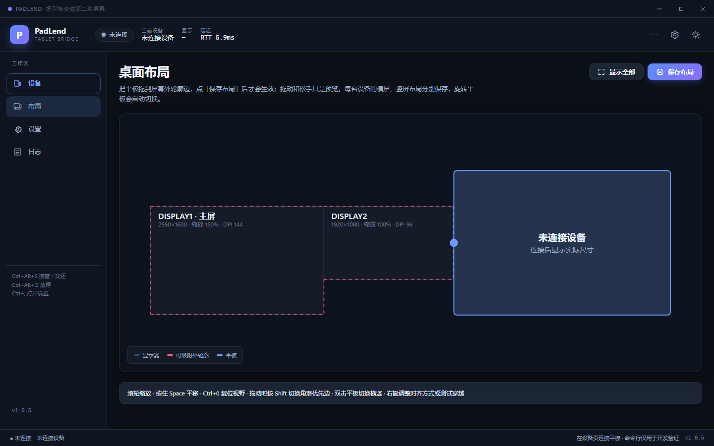

# PadLend

跨设备共享键鼠无缝操作平板。鼠标移到电脑屏幕边缘时会穿到平板上，平板出现系统指针，可以直接用鼠标和键盘操作；从平板边缘划回来，指针回到电脑上原来的位置。

一般不需要 root，不需要在平板上安装 App，也不用装驱动。PC 端通过 adb 启动 scrcpy-server，平板通过 UHID 接收虚拟鼠标和键盘输入。

当前源码版本 **2.1.0**，Apache-2.0。2.1.0 是一次审计修复版：补齐崩溃/强杀后的清理链、Raw Input 退出挂死与钩子 UAF、布局移除落盘、配置校验、日志目录与诊断脱敏；2.0.x 修掉一批真机问题：转屏识别时灵时不灵（adb 把 `sh -c` 拆开，查询每轮超时）、接管期间转屏界面不跟随、平板越用越卡（window dump 拖死 adbd）、无线调试换端口后只能重启应用、平板掉线后界面仍显示「已连接」、指针周期性卡顿；完整记录见 [CHANGELOG](docs/CHANGELOG.md)。1.7.0 起引擎（`padlend-core`）与 Tauri 2 外壳都是 Rust，Python 实现已整体移除；1.1.0 起界面为 **Tauri 2 + React 19 + TypeScript**，不再依赖 Qt/PySide6。界面外壳的迁移记录见 [docs/TAURI_MIGRATION.md](docs/TAURI_MIGRATION.md)（历史文档，其中「业务层继续用 Python」的结论已被 1.7.0 推翻），引擎协议与 Win32 设计见 [docs/DESIGN.md](docs/DESIGN.md)（1.0.x 时期设计稿），遇到问题先看 [docs/TROUBLESHOOTING.md](docs/TROUBLESHOOTING.md)，开发期踩坑见 [docs/PITFALLS.md](docs/PITFALLS.md)。



*界面截图使用演示设备数据；布局页可把平板拖到任意显示器边缘，点「保存布局」后生效。*

## 功能

- 平板按显示器边缘摆位（只共享键鼠，不占用一块显示器），支持多显示器、负坐标和混合 DPI。
- 鼠标从屏幕边缘进入平板后 1:1 移动；从平板边缘继续外推，交还给 PC。
- 通过 UHID 创建虚拟鼠标/键盘，平板显示真实的系统指针，右键、滚轮、侧键都能用。
- 键盘转发，支持中文输入法；`Ctrl+Alt+S` 手动接管/交还，`Ctrl+Alt+Q` 急停。
- 剪贴板双向同步：PC 复制自动写入平板，平板复制也会写回 Windows；只写剪贴板，不敲键盘。
- 可选的平板声音转发：把平板媒体/系统声音接到 Windows 播放，平板静音；需要 Android 11+，默认关闭。
- 布局页可视化摆位：拖到合法边缘后点「保存布局」才生效；角落按 `Shift` 切换优先边，点「显示全部」可一次看全所有显示器和平板。
- 每台设备的横屏、竖屏布局分别保存；平板旋转时按真实朝向自动切换到对应布局。
- 日间/夜间主题、托盘菜单、日志查看、脱敏诊断包。
- 退出时恢复平板指针速度，并清理遮罩、ClipCursor 和 UHID 设备。

## 环境要求

| | |
|---|---|
| PC | Windows 10/11 x64，需 WebView2 Runtime（Win11 通常已内置） |
| 平板 | Android 8.0+，且 `/dev/uhid` 可写；音频转发需 Android 11+ |
| 连接 | USB 数据线（推荐）或无线 adb |
| 开发 | Node.js 22+、Rust 1.82+（MSVC 工具链 + Windows SDK）、WebView2 运行时 |

已在 Honor MagicPad 3（CGA-W00，Android 17，3200×2136）上验证。其他机型只要 UHID 可用，首次连接会读取真实分辨率、朝向和输入参数，不按型号写死。

UHID 是硬条件。`/dev/uhid` 不可写时无法创建虚拟鼠标/键盘，平板不会出现系统光标，键鼠输入也无法接管。可以先在电脑上执行：

```bash
adb shell 'exec 3<>/dev/uhid && echo OPEN_OK'
```

返回 `OPEN_OK` 才说明可用。失败时需要换支持 UHID 的机型/ROM，或在 userdebug 固件上 `adb root` 后再试。详见[故障排查](docs/TROUBLESHOOTING.md)。

## 下载与安装

到 [GitHub Releases](https://github.com/measureer/PadLend/releases) 下载最新发布：

- `PadLend-<版本>-setup.exe`：NSIS 安装器，装到当前用户目录，不需要管理员权限。
- `PadLend-<版本>-win64.zip`：免安装包，解压即用。
- `SHA256SUMS.txt`：下载后建议核对。

以 2.1.0 为例：

```powershell
Get-FileHash .\PadLend-2.1.0-win64.zip -Algorithm SHA256
```

安装器默认装到 `%LOCALAPPDATA%\Programs\PadLend`。配置写在 `%APPDATA%\PadLend\`（`config.yaml`、`devices.json`），升级覆盖程序目录不会丢配置；日志写在 `%LOCALAPPDATA%\PadLend\`（见「日志与诊断」）。免安装包请保持 `PadLend.exe`、`padlend-core.exe` 与 `vendor\` 在同一目录。

> 当前构建没有代码签名，Windows 可能提示「未知发布者」；点「更多信息 → 仍要运行」，或按 SHA-256 核对。

## 快速开始

1. 运行 PadLend。第一次启动会打开向导，检查平板连接/USB 调试和 UHID，最后可以设置是否自动连接、关闭窗口时是否收进托盘。adb 和 scrcpy-server 已随安装包内置，不需要另外安装。
2. 在平板上打开「开发者选项 → USB 调试」，用数据线连接电脑。没有设备时，在「设备」页点「添加设备」，填无线调试的 IP、主机名或 `[IPv6]:端口`；首次配对还要填 6 位配对码。连接成功后 PadLend 会把设备记进 `devices.json`；以后同一台平板换 IP/端口，会先试记录里的历史端点，再按 mDNS 里的硬件序列号、最后按 MAC/ARP 找回来。跨网或 VPN 只要电脑能访问平板的调试端口也能用；mDNS 自动发现通常只在同一局域网有效。
3. 选中平板，点「连接此设备」。
4. 切到「布局」页，把平板拖到某个屏幕边缘的红色虚线区域，点「保存布局」。拖动和松手只是预览，不点保存不会改变实际摆位；「显示全部」会把所有显示器和平板缩放到视野内。角落位置按 `Shift` 切换优先边。布局按「设备 + 横屏/竖屏」分别保存，旋转平板后会自动切到该方向保存过的布局。
5. 把鼠标移到该边缘并继续往外推，进入接管：PC 光标隐藏，平板出现指针。把指针推到平板对应边缘再往外推，交还给 PC。

### 热键

| 热键 | 作用 |
|---|---|
| `Ctrl+Alt+S` | 手动接管 / 交还 |
| `Ctrl+Alt+Q` | 急停，立即释放鼠标、键盘和 ClipCursor |
| `Ctrl+,` | 打开设置页 |
| `Ctrl+0` | 布局画布复位视野 |

热键可以在设置里改，对应 `hotkeys.toggle` 和 `hotkeys.panic`。

### 状态颜色

| 颜色 | 状态 | 含义 |
|---|---|---|
| 灰 | 未连接 | 设备未连接，输入归 PC |
| 绿 | IDLE | 已连接，未接管 |
| 黄 | ARMING / RETURNING | 正在判断是否进入，或正在交还 |
| 红 | CAPTURED | 接管中 |
| 红（错误色） | FAULT | 连接或钩子异常，输入已交还系统 |

## 配置

配置文件在 `%APPDATA%\PadLend\config.yaml`，设备记录在同目录的 `devices.json`（自动维护，不要手改），日志在 `%LOCALAPPDATA%\PadLend\`（见[日志与诊断](#日志与诊断)）。设置 `PADLEND_HOME` 可以换一个根目录；`%APPDATA%` 不可写时会依次回退到 `%LOCALAPPDATA%\PadLend` 和程序目录下的 `.padlend\`。

首次启动会自动生成配置。常用字段：

```yaml
version: 1
device:
  serial: ""              # 空 = 自动选择第一台
  prefer_usb: true
  auto_connect: true      # false = 启动后不自动连接，在设备页手动连接
  server_port: 1234       # 1024–65535
  known: []               # 已停用：仅首次升级时迁移到 devices.json
  macs: {}                # 已停用：仅首次升级时迁移到 devices.json
placement:
  monitor: ""             # 空 = 主屏
  edge: right             # left / right / top / bottom
  span_start: 0
  span_end: 1600
  offset: 0.5             # 0–1，该边段内的相对落点
  align: proportional     # proportional / center / one_to_one
  corner_priority: right  # 角落争夺时优先的边
layouts:
  devices: {}             # 每台设备 × 横/竖屏的布局，保存布局时自动维护
motion:
  gain: 1.0               # 0.25–3.0
  report_hz: 1000         # 125 / 250 / 500 / 1000
  hid_clamp: 127          # 1–127，单次 HID 位移上限
  entry_margin_px: 2
  exit_overflow_px: 80    # 交还所需的外推距离
  debounce_ms: 250
  arm_px: 10
  arm_window_ms: 80
  edge_band_px: 1
  boundary_inset_px: 0    # 平板拦截边缘手势时可调 8–16
keyboard:
  forward: true
  suppress_pc: true
  layout: us
  passthrough_keys: []    # 1.2.0 起接管期 Win 键由 Router 强制吞掉；这里只配其它放行键
hotkeys:
  toggle: "Ctrl+Alt+S"
  panic: "Ctrl+Alt+Q"
ui:
  language: zh_CN         # 预留字段，目前仅中文界面
  theme: dark             # dark / light
  tray_notifications: true
  close_to_tray: false    # 关闭主窗时收进托盘继续运行
misc:
  clipboard_sync: true
  keep_screen_on: true
  forward_audio: false    # 1.4.0：需重新连接后生效；失败会自动退回仅控制通道
  restore_pointer_speed: -3
```

设置页能改手感、键盘、快捷键和杂项；改动先留在草稿里，点「保存设置」才写入并校验。`keep_screen_on` 会在连接期间临时把平板的系统熄屏时间调到 5 小时（原本更长则保持不变），断开或退出后还原，异常退出时下次启动补还原；设置页会明确提示这一点，不需要时可直接关闭。它不会改开发者选项里的「保持唤醒状态」。`forward_audio` 默认关闭；开启后平板的声音由 scrcpy 的 `audio_source=output` 接管并送到 Windows，平板自身不再外放，所有系统声音（含通知）都会转发，受 DRM 保护的内容可能静音。Android 11 以下或音频通道启动失败时，PadLend 会自动按 `audio=false` 重连，键鼠不受影响；该开关需要重新连接平板才生效。平板摆位在「桌面布局」页调整：拖动只预览，点「保存布局」才会写入配置并立即用于边缘穿越。

YAML 损坏、字段越界或版本过新时，程序会把原文件备份成 `config.yaml.bad-<时间戳>`，恢复默认值，并在设置页底部显示原因。

## 日志与诊断

- 引擎日志：`%LOCALAPPDATA%\PadLend\service.log`（Rust 引擎的 stderr，每次启动重建）。
- 外壳日志：`%LOCALAPPDATA%\PadLend\shell.log`（Tauri 外壳的启动/退出/panic 记录；单文件超过 1 MiB 时下次启动轮转为 `shell.log.1`）。
- 托盘菜单的「打开日志目录…」直接打开 `%LOCALAPPDATA%\PadLend`。
- 顶栏 `⋯` →「运行诊断…」会采集 adb 设备、dumpsys input、pointer_speed 和 UHID 状态，并可导出 zip。zip 里只有两个文件：`diagnostics.txt`（脱敏正文）与 `README.txt`（说明）；不含日志，需要日志时按上面的路径另取。序列号、IP、MAC、用户名和用户目录默认打码。
- 托盘菜单的「复制诊断信息」只复制版本、系统、jar 状态等静态摘要，不会跑 adb。

## 常见问题

| 现象 | 先看 |
|---|---|
| SmartScreen 提示「未知发布者」 | 点「更多信息 → 仍要运行」，或核对 SHA-256 |
| 提示缺少 WebView2 | 安装 [WebView2 Runtime](https://developer.microsoft.com/microsoft-edge/webview2/) |
| 找不到 scrcpy-server jar，或校验失败 | 重新解压发布包；`vendor/scrcpy-server-v5.0.1.jar` 缺失或与 `vendor/SHA256SUMS` 不符 |
| 平板不显示光标，键鼠没反应 | UHID 不可写，先按上面的命令自检 |
| 设备页显示 unauthorized | 在平板上点「允许 USB 调试」，勾选「始终允许」，再刷新 |
| 无线 adb 连不上 | 确认电脑能访问平板的调试端口；跨网/VPN 直接填 IP、主机名或 `[IPv6]:端口`，mDNS 自动发现通常只同一局域网；重新配对 |
| 边缘手势被平板抢走 | 调大 `motion.boundary_inset_px`（8–16） |
| 交还太灵敏或太迟钝 | 调 `motion.exit_overflow_px`（默认 80）或 `debounce_ms` |

更完整的排障步骤见 [docs/TROUBLESHOOTING.md](docs/TROUBLESHOOTING.md)；开发期踩坑与失效安全记录见 [docs/PITFALLS.md](docs/PITFALLS.md)。

## 架构

```text
PadLend/
├─ src/                    # React 19 + TS 前端（设计系统、页面、对话框、状态）
│  ├─ api/                 # 传输契约 + 浏览器演示后端
│  ├─ store/               # 单一状态源与事件订阅
│  ├─ lib/                 # 纯逻辑、动作编排、几何与配置 schema
│  ├─ components/          # 统一组件库与图标
│  └─ features/            # 设备 / 布局 / 设置 / 日志 / 向导 / 诊断
├─ src-tauri/              # Tauri 2 Rust 外壳（窗口、托盘、单实例、剪贴板、引擎生命周期）
├─ padlend-core/           # Rust 业务引擎（NDJSON over stdin/stdout，唯一实现）
│  ├─ src/logic/           # 状态机、几何、指标、路由
│  ├─ src/win/             # DPI、桌面几何、Raw Input、遮罩、钩子、热键
│  ├─ src/tablet/          # adb、协议、UHID、server、session、键盘映射
│  └─ src/service/         # RPC 方法、序列化、诊断、设备注册表
├─ tools/                  # PowerShell 构建与发版脚本
├─ vendor/                 # scrcpy-server jar、内置 adb、SHA256SUMS
├─ frontend-dist/          # 前端构建输出（与 dist/ 分离）
└─ dist/                   # 发布产物
```

线程模型：Tauri WebView 只负责渲染；Rust 外壳转发 RPC；引擎每个 RPC 请求独立线程（慢请求不再堵住后面的请求），Router / 发送 / 监督 / Raw Input / 键盘钩子各占独立线程。发送队列满时丢最老的输入，并计入 `drop_pct`。

1.7.0 起 Python 实现（`core/`、`win/`、`tablet/`、`service/`、`padlend-service.exe`）已整体移除，仓库里只剩 Rust 引擎与 Tauri 外壳两套代码。

> `docs/DESIGN.md` 是 1.0.x 时期的设计稿：协议与 Win32 输入链路章节仍有参考价值，Python/PySide6 模块布局与 Qt 章节已被 1.7.0 的 Rust 实现和 Tauri 2 外壳取代。迁移期的 B2/可行性/验收报告已归档到 [docs/archive/](docs/archive/)。

## 从源码构建

依赖：Node 22+、Rust 1.82+（引擎 `rust-version`；外壳为 1.77.2，构建整个仓库按 1.82 装）、MSVC 工具链 + Windows SDK、WebView2 运行时。

```powershell
npm ci

# 浏览器预览（无需 Rust，使用内存演示设备）
npm run dev
# http://127.0.0.1:1420/?page=layout&theme=light

# 开发期桌面应用：先编译引擎，外壳会在自身目录里找 padlend-core.exe
powershell -ExecutionPolicy Bypass -File tools\build-core.ps1
npm run tauri:dev
```

一条命令出发布产物（编译引擎 → 前端 → Tauri 外壳 → NSIS 安装包 → 免安装 zip → SHA256）：

```powershell
powershell -ExecutionPolicy Bypass -File tools\release.ps1
```

产物落在 `src-tauri/target/release/bundle/nsis/PadLend_<版本>_x64-setup.exe` 与 `dist/`。

`vendor/scrcpy-server-v5.0.1.jar` 和 `vendor/adb/platform-tools/` 随仓库提供，校验和见 `vendor/SHA256SUMS`。adb 的查找顺序是：`PADLEND_ADB` → 内置 `vendor/adb/platform-tools/` → PATH → 常见 SDK 目录。

## 开发与验收

```powershell
cargo test --manifest-path padlend-core\Cargo.toml   # 引擎单测 + fixture 回放（532 例）
cargo test --manifest-path src-tauri\Cargo.toml      # 外壳单测
npx vitest run                                      # 前端单元与交互测试
npm run build                                       # tsc --noEmit + vite build
```

`padlend-core/tests/fixtures/` 里的 router 场景、UHID 报文、Raw Input 解码向量都是 B2 迁移期固化下来的对拍基线：Rust 实现必须逐字节复现，改动引擎行为时先跑 `cargo test`。

## 已知限制

- 未签名：没有代码签名证书，SmartScreen 会提示「未知发布者」。
- 管理员窗口收不到输入：以管理员权限运行的窗口收不到低级键盘/鼠标钩子，这是 Windows 的限制。
- UHID 是硬条件：`/dev/uhid` 不可写时无法创建虚拟鼠标/键盘，不能接管输入。
- 多显示器组合（负坐标、跨屏同侧、角落裁决）有 fixture 单测覆盖，但仍需要双屏实机复验。
- 无线性能：adbd 抖动时降低 `report_hz` 或改用 USB；部分路由器开了 AP 隔离时无线调试不可用。
- 无自动更新：升级时下载新 Release，覆盖程序目录即可，配置会保留。
- 当前只有中文界面。

## 许可

Apache-2.0。Tauri、React、scrcpy、Android platform-tools 等第三方组件的许可证和归属见 [THIRD_PARTY_NOTICES.md](THIRD_PARTY_NOTICES.md)，发布包的 `LICENSES/` 目录里有许可证原文。程序内「关于 PadLend…」可以查看版本、许可摘要并打开该文件。

平板端的 scrcpy server jar 和协议来自 [scrcpy](https://github.com/Genymobile/scrcpy)（Apache-2.0），PadLend 侧的协议实现是独立编写的。
