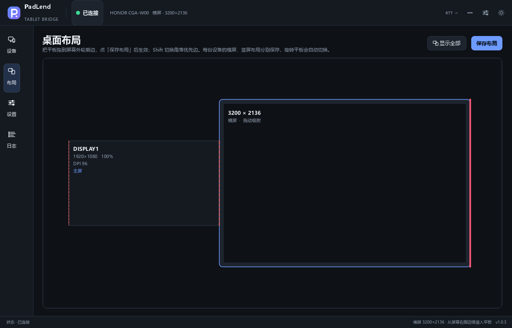

# PadLend

把 Android 平板当成 Windows 的第二块屏幕。鼠标移到电脑屏幕边缘时会穿到平板上，平板出现系统指针，可以直接用鼠标和键盘操作；从平板边缘划回来，指针回到电脑上原来的位置。

一般不需要 root，不需要在平板上安装 App，也不用装驱动。PC 端通过 adb 启动 scrcpy-server，平板通过 UHID 接收虚拟鼠标和键盘输入。

当前源码版本 1.0.3，最新发布 1.0.1；Apache-2.0。设计思路见 [docs/DESIGN.md](docs/DESIGN.md)，遇到问题先看 [docs/TROUBLESHOOTING.md](docs/TROUBLESHOOTING.md)。



*界面截图使用演示设备数据；布局页可把平板拖到任意显示器边缘，点「保存布局」后生效。*

## 功能

- 平板作为 Windows 扩展屏，支持多显示器、负坐标和混合 DPI。
- 鼠标从屏幕边缘进入平板后 1:1 移动；从平板边缘继续外推，交还给 PC。
- 通过 UHID 创建虚拟鼠标/键盘，平板显示真实的系统指针，右键、滚轮、侧键都能用。
- 键盘转发，支持中文输入法；`Ctrl+Alt+S` 手动接管/交还，`Ctrl+Alt+Q` 急停。
- 布局页可视化摆位：拖到合法边缘后点「保存布局」才生效；角落按 `Shift` 切换优先边，点「显示全部」可一次看全所有显示器和平板。
- 每台设备的横屏、竖屏布局分别保存；平板旋转时按真实朝向自动切换到对应布局。
- 日间/夜间主题、托盘菜单、日志查看、脱敏诊断包。
- 退出时恢复平板指针速度，并清理遮罩、ClipCursor 和 UHID 设备。

## 环境要求

| | |
|---|---|
| PC | Windows 10/11 x64 |
| 平板 | Android 8.0+，且 `/dev/uhid` 可写 |
| 连接 | USB 数据线（推荐）或无线 adb |
| 开发 | Python 3.11+（开发使用 3.13） |

已在 Honor MagicPad 3（CGA-W00，Android 17，3200×2136）上验证。其他机型只要 UHID 可用，首次连接会读取真实分辨率、朝向和输入参数，不按型号写死。

UHID 是硬条件。`/dev/uhid` 不可写时无法创建虚拟鼠标/键盘，平板不会出现系统光标，键鼠输入也无法接管。可以先在电脑上执行：

```bash
adb shell 'exec 3<>/dev/uhid && echo OPEN_OK'
```

返回 `OPEN_OK` 才说明可用。失败时需要换支持 UHID 的机型/ROM，或在 userdebug 固件上 `adb root` 后再试。详见[故障排查](docs/TROUBLESHOOTING.md)。

## 下载与安装

到 [GitHub Releases](https://github.com/measureer/PadLend/releases) 下载最新发布：

- `PadLend-1.0.1-win64.zip`：免安装包，解压即用。
- `PadLend-1.0.1-setup.exe`：可选安装器，装到当前用户目录，不需要管理员权限。
- `SHA256SUMS.txt`：下载后建议核对。

### 校验

```powershell
Get-FileHash .\PadLend-1.0.1-win64.zip -Algorithm SHA256
```

把结果和 `SHA256SUMS.txt` 中对应行比对即可。

### 免安装包

解压到任意可写目录，运行 `PadLend.exe`。不要只把 exe 单独挪走，`_internal\` 里是运行时：

```text
PadLend\
├─ PadLend.exe
├─ _internal\
├─ LICENSES\
└─ THIRD_PARTY_NOTICES.md
```

整个目录约 129 MB，zip 约 51 MB。配置和日志默认写在 `%APPDATA%\PadLend\`，所以换新版时直接覆盖程序目录，配置还在。

### 安装器

安装器默认装到 `%LOCALAPPDATA%\Programs\PadLend`。卸载程序不会删除 `%APPDATA%\PadLend\` 里的配置和日志。

### SmartScreen

当前构建没有代码签名，Windows 可能提示“Windows 已保护你的电脑”。点“更多信息 → 仍要运行”即可。个别杀软会把 PyInstaller 打包的 exe 误报为可疑程序，可以核对 SHA-256，或者按[从源码构建](#从源码构建)自己打包。

## 快速开始

1. 运行 `PadLend.exe`。第一次启动会打开向导，依次检查 adb、USB 调试、UHID 和 scrcpy-server，最后可以设置是否自动连接、关闭窗口时是否收进托盘。
2. 在平板上打开“开发者选项 → USB 调试”，用数据线连接电脑。没有设备时，在「设备」页点「添加设备」，填无线调试的 IP 和端口；首次配对还要填 6 位配对码。设备页的「刷新设备」会重新扫描 adb；如果 adb 自带的 mDNS 不可用，PadLend 会自己发 mDNS 查询找无线调试端口，再按每台设备保存的 MAC 用 ARP 表确认新 IP。平板换了 IP 或无线调试端口，一般也能重新出现。
3. 选中平板，点「连接此设备」。
4. 切到「布局」页，把平板拖到某个屏幕边缘的红色虚线区域，点「保存布局」。拖动和松手只是预览，不点保存不会改变实际摆位；「显示全部」会把所有显示器和平板缩放到视野内。角落位置按 `Shift` 切换优先边。布局按“设备 + 横屏/竖屏”分别保存，旋转平板后会自动切到该方向保存过的布局。
5. 把鼠标移到该边缘并继续往外推，进入接管：PC 光标隐藏，平板出现指针。把指针推到平板对应边缘再往外推，交还给 PC。

### 热键

| 热键 | 作用 |
|---|---|
| `Ctrl+Alt+S` | 手动接管 / 交还 |
| `Ctrl+Alt+Q` | 急停，立即释放鼠标、键盘和 ClipCursor |

热键可以在设置里改，对应 `hotkeys.toggle` 和 `hotkeys.panic`。

### 状态颜色

| 颜色 | 状态 | 含义 |
|---|---|---|
| 灰 | 未连接 | 设备未连接，输入归 PC |
| 绿 | IDLE | 已连接，未接管 |
| 黄 | ARMING / RETURNING | 正在判断是否进入，或正在交还 |
| 红 | CAPTURED | 接管中 |
| 红（错误色） | FAULT | 连接或钩子异常，输入已交还系统 |

## 配置

配置文件在 `%APPDATA%\PadLend\config.yaml`，日志在同目录的 `logs\` 下。设置 `PADLEND_HOME` 可以换一个根目录；`%APPDATA%` 不可写时会依次回退到 `%LOCALAPPDATA%\PadLend` 和程序目录下的 `.padlend\`。

首次启动会自动生成配置。常用字段：

```yaml
version: 1
device:
  serial: ""              # 空 = 自动选择第一台
  prefer_usb: true
  auto_connect: true      # false = 启动后不自动连接，在设备页手动连接
  server_port: 1234       # 1024–65535
  known: []               # 最近连接过的序列号（自动维护）
  macs: {}                # 每台无线设备的 Wi-Fi MAC，键为地址（自动维护）
placement:
  monitor: ""             # 空 = 主屏
  edge: right             # left / right / top / bottom
  span_start: 0
  span_end: 1600
  offset: 0.5             # 0–1，该边段内的相对落点
  align: proportional     # proportional / center / one_to_one
  corner_priority: right  # 角落争夺时优先的边
layouts:
  devices: {}             # 每台设备 × 横/竖屏的布局，保存布局时自动维护
motion:
  gain: 1.0               # 0.25–3.0
  report_hz: 1000         # 125 / 250 / 500 / 1000
  hid_clamp: 127          # 1–127，单次 HID 位移上限
  entry_margin_px: 2
  exit_overflow_px: 120   # 交还所需的外推距离
  debounce_ms: 250
  arm_px: 40
  arm_window_ms: 80
  edge_band_px: 1
  boundary_inset_px: 0    # 平板拦截边缘手势时可调 8–16
keyboard:
  forward: true
  suppress_pc: true
  layout: us
  passthrough_keys: ["VK_LWIN", "VK_RWIN"]
hotkeys:
  toggle: "Ctrl+Alt+S"
  panic: "Ctrl+Alt+Q"
ui:
  language: zh_CN         # 预留字段，目前仅中文界面
  theme: dark             # dark / light
  tray_notifications: true
  show_pointer_ghost: true
  close_to_tray: false    # 关闭主窗时收进托盘继续运行
misc:
  clipboard_sync: true
  keep_screen_on: true
  restore_pointer_speed: -3
```

设置页能改手感、键盘、快捷键和杂项。平板摆位在「桌面布局」页调整：拖动只预览，点「保存布局」才会写入配置并立即用于边缘穿越；角落优先边用 `Shift` 在画布上切换。布局按设备身份（优先 `ro.serialno`）和横/竖屏分别保存到 `layouts.devices`，平板旋转时自动切换；同一台设备的新方向还没保存过时，会保留当前摆位等你调整。需要精确数值时再直接改 YAML。

改完点“保存设置”，或者重启程序。YAML 损坏、字段越界或版本过新时，程序会把原文件备份成 `config.yaml.bad-<时间戳>`，恢复默认值，并在设置页底部显示原因。

## 日志与诊断

- `%APPDATA%\PadLend\logs\padlend.log`：运行日志，2 MB 轮转，保留 3 个文件。
- `logs\crash-YYYYmmdd-HHMMSS-<pid>.log`：未捕获异常的 traceback、版本和启动参数。
- `logs\faulthandler-*.log`：原生崩溃时的全线程栈。
- 托盘菜单的「打开日志目录…」可以直接打开上述目录。
- 顶栏 `⋯` →「运行诊断…」会采集 adb 设备、dumpsys input、pointer_speed、UHID 状态和最近 512 KB 日志，并可导出 zip。序列号、IP、MAC、用户名和用户目录默认打码。
- 托盘菜单的「复制诊断信息」只复制版本、系统、jar 状态等静态摘要，不会跑 adb。

## 常见问题

| 现象 | 先看 |
|---|---|
| SmartScreen 提示“未知发布者” | 点“更多信息 → 仍要运行”，或核对 SHA-256 |
| 找不到 scrcpy-server jar，或校验失败 | 重新解压发布包；`vendor/scrcpy-server-v5.0.1.jar` 缺失或与 `vendor/SHA256SUMS` 不符 |
| 平板不显示光标，键鼠没反应 | UHID 不可写，先按上面的命令自检 |
| 设备页显示 unauthorized | 在平板上点“允许 USB 调试”，勾选“始终允许”，再刷新 |
| 无线 adb 连不上 | 确认平板和电脑在同一网段，无线调试端口没被路由器隔离；重新配对 |
| 边缘手势被平板抢走 | 调大 `motion.boundary_inset_px`（8–16） |
| 交还太灵敏或太迟钝 | 调 `motion.exit_overflow_px`（默认 120）或 `debounce_ms` |

更完整的排障步骤见 [docs/TROUBLESHOOTING.md](docs/TROUBLESHOOTING.md)。

## 从源码构建

```powershell
git clone https://github.com/measureer/PadLend.git C:\Code\PadLend
cd C:\Code\PadLend
python -m venv .venv
.\.venv\Scripts\python.exe -m pip install -U pip
.\.venv\Scripts\python.exe -m pip install -e ".[dev]"

# 直接运行
.\.venv\Scripts\python.exe -m padlend
```

`vendor/scrcpy-server-v5.0.1.jar` 和 `vendor/adb/platform-tools/` 随仓库提供，校验和见 `vendor/SHA256SUMS`。adb 的查找顺序是：`PADLEND_ADB` → 内置 `vendor/adb/platform-tools/` → PATH → 常见 SDK 目录。

打包：

```powershell
.\.venv\Scripts\python.exe -m pip install -r requirements-build.txt
.\.venv\Scripts\python.exe tools\release.py --build --zip --sha256
```

输出在 `dist\`：`PadLend\`（onedir）、`PadLend-<版本>-win64.zip`、`SHA256SUMS.txt`。加 `--installer` 需要预装 Inno Setup 6.3+；加 `--sign` 需要设置 `PADLEND_SIGN_CERT` 和 `PADLEND_SIGN_PASSWORD`，没有证书时会跳过并提示未签名。这个脚本只生成本地产物，上传由 GitHub Release 工作流完成。

## 开发与验收

```powershell
# 单元测试，不需要平板或显示器
.\.venv\Scripts\python.exe -m pytest -q

# 代码风格
.\.venv\Scripts\python.exe -m ruff check .

# 探测真实设备
.\.venv\Scripts\python.exe tools\probe.py

# 端到端验收：假平板 + 真实遮罩/ClipCursor/状态机
.\.venv\Scripts\python.exe tools\acceptance.py

# 用假平板启动 GUI
.\.venv\Scripts\python.exe main.py --simulate

# 重新生成截图
.\.venv\Scripts\python.exe tools\make_screenshots.py
```

`acceptance.py` 走真实代码路径，不 mock 被测逻辑。进入接管后会检查遮罩是否吞掉 `WM_SETCURSOR`、`ClipCursor` 是否钉在屏幕边缘的 1px 条上，再用真实输入事件验证单击、连点、双击和拖动，最后交还并检查遮罩销毁、`ClipCursor` 解除。本机光标不可观测（远程桌面或无头会话）时，相关检查会标成 SKIP。

排查“接管时电脑上又冒出鼠标”，可以看 `docs/VERIFICATION.md` 里的 `cap.cursor` 日志：接管期间每次按下/抬起都会记录 `visible=… clip=… windows=… active=…`。

### 目录结构

```text
PadLend/
├─ main.py                 # 组合根、生命周期、CLI
├─ constants.py            # 常量、HID 描述符、路径
├─ config.py               # 配置、校验、损坏恢复
├─ core/                   # 状态机、几何、估计器、错误、日志、崩溃
├─ win/                    # DPI、桌面几何、Raw Input、遮罩、钩子、热键
├─ tablet/                 # adb、协议、UHID、server、session、键盘映射
├─ ui/                     # 主窗、画布、设置、日志、托盘、向导、诊断
├─ tools/                  # probe / calibrate / acceptance / release / 截图
├─ installer/              # Inno Setup 脚本
├─ vendor/                 # scrcpy-server jar、内置 adb、SHA256SUMS
├─ LICENSES/               # 第三方许可证原文
└─ THIRD_PARTY_NOTICES.md  # 第三方组件说明
```

线程模型：GUI、Raw Input、键盘钩子、Router、发送、监督各一个线程；发送队列满时丢最老的输入，并计入 `drop_pct`。

## 已知限制

- 未签名：没有代码签名证书，SmartScreen 会提示“未知发布者”。
- 管理员窗口收不到输入：以管理员权限运行的窗口（UAC 提权程序）收不到本程序的低级键盘/鼠标钩子，这是 Windows 的限制。
- UHID 是硬条件：`/dev/uhid` 不可写时无法创建虚拟鼠标/键盘，不能接管输入。
- 多显示器组合（负坐标、跨屏同侧、角落裁决）有 fixture 单测覆盖，但仍需要双屏实机复验。
- 边缘手势：MagicOS 等系统可能拦截边缘滑动，可以调大 `boundary_inset_px`。
- 无线性能：adbd 抖动时降低 `report_hz` 或改用 USB；部分路由器开了 AP 隔离时无线调试不可用。
- 无自动更新：当前版本没有内置更新器；升级时下载新 Release，覆盖程序目录即可，配置会保留。
- 当前只有中文界面。

## 许可

Apache-2.0。PySide6/Qt、scrcpy、Android platform-tools、PyYAML、psutil、PyInstaller 等第三方组件的许可证和归属见 [THIRD_PARTY_NOTICES.md](THIRD_PARTY_NOTICES.md)，发布包的 `LICENSES/` 目录里有许可证原文。程序内「关于 PadLend…」可以查看版本、许可摘要并打开该文件。

平板端的 scrcpy server jar 和协议来自 [scrcpy](https://github.com/Genymobile/scrcpy)（Apache-2.0），PadLend 侧的协议实现是独立编写的。
