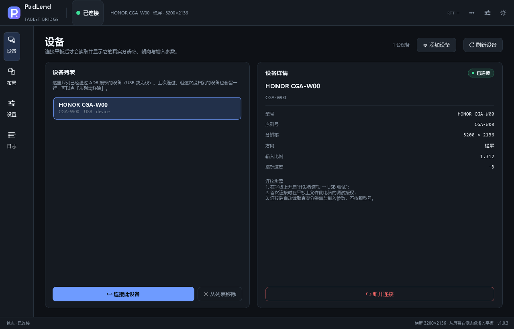
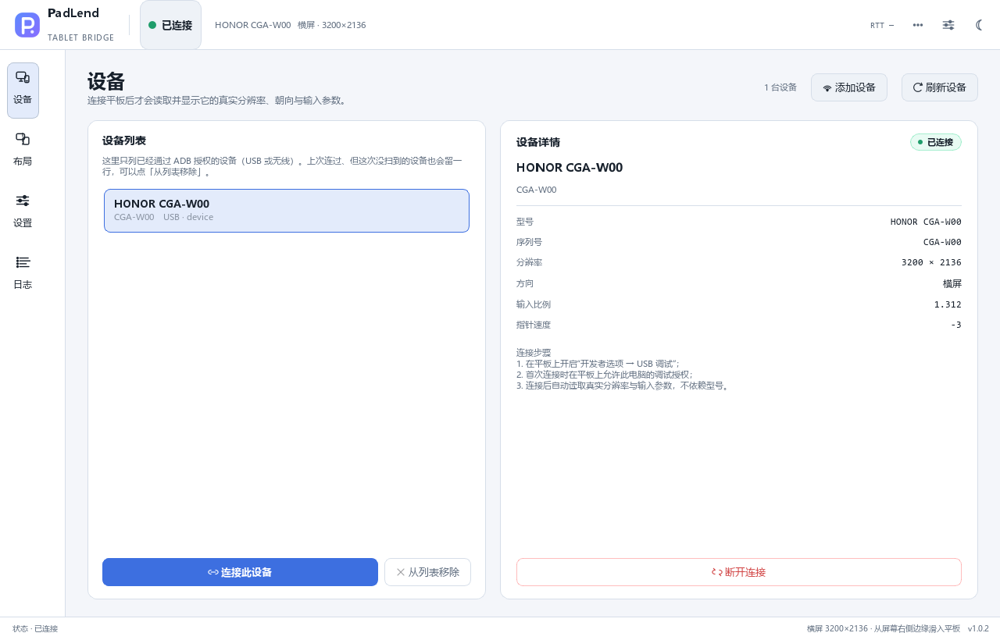

# PadLend

把 Android 平板变成 Windows 的第二块屏幕输入设备：鼠标从 PC 屏幕边缘"穿"进平板，平板出现系统鼠标指针并接受真实的鼠标/键盘输入；从平板边缘划回时，指针交还给 PC 原位置。无需 root、无需装驱动、无需在平板上安装 App。

> 设计文档：[docs/DESIGN.md](docs/DESIGN.md)；故障排查：[docs/TROUBLESHOOTING.md](docs/TROUBLESHOOTING.md)；变更记录：[docs/CHANGELOG.md](docs/CHANGELOG.md)。

## 特性

- **位置感知**：维护一个"平板指针估计器"，进入时按吸附位置 warp 到对应点，之后 1:1 跟随，回程时按估计器位置交还给 PC。
- **边缘穿越**：以虚拟桌面外轮廓边段为唯一吸附目标；支持多显示器、负坐标、混合 DPI、跨屏同侧合并、角落裁决（Shift 切换）。
- **系统指针**：通过 UHID 注册虚拟鼠标/键盘，平板显示真实的系统指针，支持 Android 原生光标、右键、滚轮、侧键。
- **可拖拽画布**：可视化摆放平板（吸附到合法外轮廓段），实时预览入口/落点。
- **键盘转发**：低级键盘钩子 + VK→HID 全表，6KRO，修饰键同步，中文输入法可用；`Ctrl+Alt+S` 接管/交还、`Ctrl+Alt+Q` 急停。
- **崩溃兜底**：三层清理（异常路径 / 看门狗 / 下次启动检测 `exit.clean`），不会留下锁死的 ClipCursor 或幽灵 UHID。
- **无侵入**：不修改系统设置（仅临时归零 `pointer_speed`，退出还原）；不安装驱动；不需要管理员权限。
- **设备管理**：启动即列出 adb 设备，型号/序列号/传输方式/授权状态一目了然；用户显式连接/断开，未连接时不假设平板分辨率。
- **昼 / 夜双主题**：顶栏右侧太阳/月亮按钮一键切换，选择写入配置并在下次启动恢复；亮色与深色共用同一套布局与控件。

## 界面






## 环境要求

| 项目 | 要求 |
|---|---|
| PC | Windows 10/11 x64，Python 3.11+（开发用 3.13） |
| 平板 | Android 8.0+（UHID 可用；本项目在 Honor MagicPad 3 / Android 17 上验证） |
| 工具 | 打包版已内置 adb；源码运行需 Android platform-tools（`adb` 在 PATH 或设置 `PADLEND_ADB`） |
| 连接 | USB 数据线（推荐）或无线 adb；平板已开启"USB 调试" |

> UHID 需要平板的 `uhid` 组权限；主流厂商系统默认允许 `adb shell` 访问 `/dev/uhid`。若 `probe` 报告不可写，见故障排查。

## 安装

普通用户：直接双击 `dist\PadLend.exe`，无需安装 Python、adb 或任何驱动。
配置、日志与退出标记会写在该 exe 同目录的 `.padlend\` 中，可整体拷贝运行。

源码开发：

```powershell
git clone <repo> C:\Code\PadLend
cd C:\Code\PadLend
python -m venv .venv
.\.venv\Scripts\python.exe -m pip install -U pip
.\.venv\Scripts\python.exe -m pip install -e ".[dev]"
```

`vendor/scrcpy-server-v5.0.1.jar` 已随仓库提供（SHA-256 见 `vendor/SHA256SUMS`）。缺失时程序会给出明确提示。

## 快速开始

打包版：双击 `dist\PadLend.exe`，在「设备」页刷新并选择平板 → 连接 → 切到「布局」页拖到屏幕边缘。
首次连接会读取设备真实分辨率、朝向与输入参数，不再假设固定型号尺寸。

源码运行：

```powershell
# 1. 确认设备
adb devices -l

# 2. 读取平板事实（分辨率 / 朝向 / XScale / pointer_speed / UHID 可写）
.\.venv\Scripts\python.exe tools\probe.py

# 3. 启动 GUI
.\.venv\Scripts\python.exe -m padlend

# 4. 无 GUI 模式（开发/诊断用；连接后把鼠标位移 1:1 送到平板）
.\.venv\Scripts\python.exe -m padlend --headless
```

首次启动会显示向导（可跳过）：选择设备 → 确认 USB 调试 → 检查 UHID → 校验 jar；也可以跳过向导，直接在「设备」页连接平板，再到「布局」页拖到屏幕边缘。源码运行配置默认在 `%APPDATA%\PadLend\config.yaml`（不可写时回退 `%LOCALAPPDATA%` 或项目 `.padlend\`）；打包版固定使用 exe 同目录 `.padlend\config.yaml`。

## 使用

1. 打开「设备」页，刷新并选择平板，点「连接此设备」；未连接时画布只显示占位，不显示任何分辨率。
2. 连接成功后切到「布局」页，把平板拖到某个**外轮廓边段**（红色虚线高亮），松手即保存；角落可按住 `Shift` 切换优先边。
3. 鼠标移到该边缘并继续向外推 → 进入**接管**（托盘变红，PC 光标隐藏，平板出现指针）。
4. 在平板上正常使用鼠标/键盘；把指针推到平板对应边缘并继续外推 → **交还**，PC 光标回到进入点附近。
5. 热键：
   - `Ctrl+Alt+S` 手动接管/交还
   - `Ctrl+Alt+Q` 急停（立刻释放鼠标/键盘/ClipCursor）
   - `Ctrl+Alt+V` 剪贴板同步（可选）
6. 顶栏右侧的太阳/月亮按钮切换白天/黑夜主题，选择会保存并在下次启动时恢复。

### 状态颜色

| 状态 | 托盘/顶栏 | 含义 |
|---|---|---|
| 灰 | 未连接 | 设备未连上，输入归 PC |
| 绿 | IDLE | 已连接、未接管 |
| 黄 | ARMING / RETURNING | 边缘外推观察窗口 / 正在交还 |
| 红 | CAPTURED | 接管中 |
| 红（错误色） | FAULT | 连接/钩子异常，输入已全部交还系统 |

## 配置

配置文件：`%APPDATA%\PadLend\config.yaml`（日志在 `%APPDATA%\PadLend\logs\`）。
受限环境若 `%APPDATA%` 不可写，会依次回退到 `%LOCALAPPDATA%\PadLend`、项目下 `.padlend/`；`PADLEND_HOME` 可显式覆盖配置根目录。

```yaml
version: 1
device:
  serial: ""            # 空 = 自动选择第一台
  prefer_usb: true
  auto_connect: true
  server_port: 1234
placement:
  monitor: ""           # 空 = 主屏
  edge: right           # left/right/top/bottom
  span_start: 0
  span_end: 1600
  offset: 0.5
  align: proportional   # proportional/center/one_to_one
  corner_priority: right
motion:
  gain: 1.0
  report_hz: 1000
  arm_px: 40
  arm_window_ms: 80
  exit_overflow_px: 24
  entry_guard_px: 160     # 进入后先深入这么多像素，才允许穿回 PC
  debounce_ms: 250
  edge_band_px: 1
  boundary_inset_px: 0
keyboard:
  forward: true
  suppress_pc: true
  layout: us
  passthrough_keys: ["VK_LWIN", "VK_RWIN"]
hotkeys:
  toggle: "Ctrl+Alt+S"
  panic: "Ctrl+Alt+Q"
  clipboard: "Ctrl+Alt+V"
ui:
  language: zh_CN
  theme: dark            # dark / light
  tray_notifications: true
  show_pointer_ghost: true
misc:
  clipboard_sync: true
  keep_screen_on: true
  restore_pointer_speed: -3
```

修改配置后可在设置面板点"保存"，或在托盘菜单选"重载配置"。

## 开发

```powershell
# 单元测试（不需要平板/显示器）
.\.venv\Scripts\python.exe -m pytest -q

# 代码风格
.\.venv\Scripts\python.exe -m ruff check .

# 真实设备探测
.\.venv\Scripts\python.exe tools\probe.py
```

目录结构：

```
PadLend/
├─ main.py                 # 组合根 / 生命周期
├─ constants.py            # 全部常量、HID 描述符、超时
├─ config.py               # 配置数据类、校验、迁移
├─ core/                   # 状态机、几何、估计器、错误、日志、指标
├─ win/                    # DPI、桌面几何、Raw Input、遮罩、钩子、热键、单实例
├─ tablet/                 # adb、协议、UHID、server、session、keymap、估计器
├─ ui/                     # 主窗、画布、设置、日志、托盘、向导、诊断、主题
├─ tools/                  # probe / calibrate
├─ tests/                  # 单元 + 集成（fake 设备）
└─ vendor/                 # scrcpy-server jar、内置 adb、SHA256SUMS
```

线程模型：T1 GUI、T2 Raw Input、T3 键盘钩子、T4 Router、T5 发送、T6 监督；队列满时丢最老并计入 `drop_pct`。

## 打包

```powershell
.\.venv\Scripts\python.exe -m pip install pyinstaller
.\.venv\Scripts\python.exe -m PyInstaller --noconfirm PadLend.spec
```

输出单文件 `dist\PadLend.exe`（约 51MB，含 PySide6 运行时、`vendor/scrcpy-server-v5.0.1.jar`
与内置 adb），双击即可运行，不依赖本机 Python/adb。

- `PadLend.spec` 使用 `runtime_tmpdir="."`：受限 Windows 配置下 `%TEMP%` 不可写时，
  单文件解包目录放在 exe 同目录。
- 首次运行校验 `vendor/` 完整性；配置/日志/`exit.clean` 写在 exe 同目录 `.padlend\`。

## 已知限制

- 单文件 exe 未做代码签名，Windows SmartScreen 可能提示“未知发布者”；选择“更多信息 → 仍要运行”即可。
- 以管理员权限运行的窗口（UAC 提权程序）收不到本程序的钩子注入，这是 Windows 低级钩子的固有限制。
- 多显示器 A4–A6 场景需要在双屏环境复验；逻辑已由 fixture 单测覆盖。
- 平板系统若拦截边缘手势（MagicOS 等），可把 `boundary_inset_px` 调大 2–4px。
- 无线 adb 抖动时建议降低 `motion.report_hz` 或改用 USB。

## 许可

Apache-2.0。使用/借鉴了 [scrcpy](https://github.com/Genymobile/scrcpy)（Apache-2.0）的 server jar 与控制协议；协议实现为独立编写。
